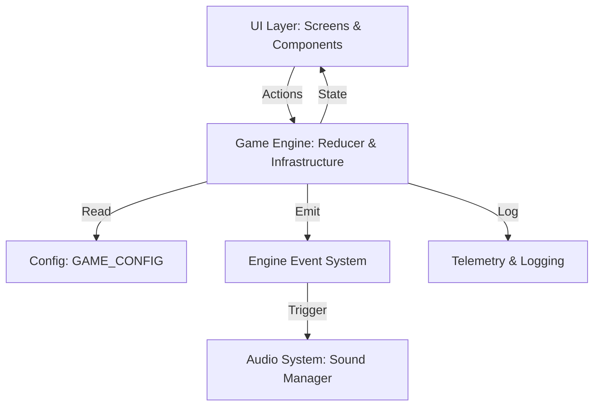

# WumpusAdventures — Architecture Documentation

This document describes the high-level architecture and data flow of **WumpusAdventures**.

## 1. System Layers

The application follows a strictly decoupled layered architecture to ensure that game logic, state management, and media playback remain independent.

### Component Interaction Diagram

## 2. Layer Definitions

### A. Game Engine Layer (`src/core/engine`)
The core logic of the game, implemented as a pure functional reducer. It relies on the **Infrastructure Layer** to handle cross-cutting concerns.

### B. Infrastructure Layer (`src/core/*`)
Supporting systems that enhance the core engine:
- **Config**: Centralized constants in `GAME_CONFIG.ts`.
- **Difficulty**: Level-based scaling formulas.
- **Random**: Deterministic PRNG for seeded map generation.
- **Events**: Internal engine event bus for decoupled side-effects (e.g., sound).
- **Telemetry**: Performance and gameplay activity logging.
- **Replay**: Action history recording for state restoration.

### C. State Management Layer
- **Runtime Gameplay State**: Localized to the `useGameEngine` hook. Includes a `seed` for deterministic behavior.
- **Global Audio State**: Managed via **Zustand** to maintain music across screens.

### D. Audio System Architecture
The audio system is decoupled from the engine via the **Engine Event System**:
1. Engine emits an event (e.g., `ENEMY_KILLED`).
2. `SoundManager` subscribes to these events.
3. `SoundManager` triggers the appropriate sound from the `SoundStore`.

### E. UI Rendering Layer (`src/ui`, `src/screens`)
Functional React components that act as pure observers:
- **Screens**: Orchestrate data fetching (highscores) and engine initialization.
- **Components**: Receive state as props and render the graphical representation.

### E. Navigation Flow
Managed via `@react-navigation/native-stack`:
- **CoverScreen**: Entry point; toggles menu music.
- **CharactersScreen**: Narrative/Character selection; triggers `SELECTION_SCREEN_START`.
- **GameScreen**: The core gameplay stage.
- **HighScoresScreen**: Persistence viewing.

## 3. Data Flow Example: Player Move
1. User clicks **UP** on the `DirectionPad`.
2. `useGameEngine` receives the `MOVE` action.
3. **Reducer** calculates the new index, checks for collisions, and updates score.
4. **UI** triggers a re-render of `BoardView` with the new player position.
5. **Effect Hook** in `GameScreen` (noticing a valid move) calls `emitSound('MOVE')`.
6. **Sound Manager** triggers `sounds.movimiento.play()` in the background.

For gameplay rules, see [GAMEPLAY_SPEC.md](GAMEPLAY_SPEC.md).
